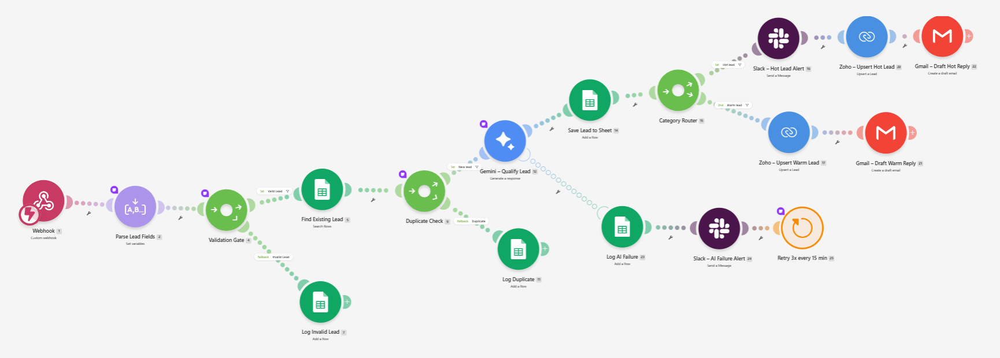
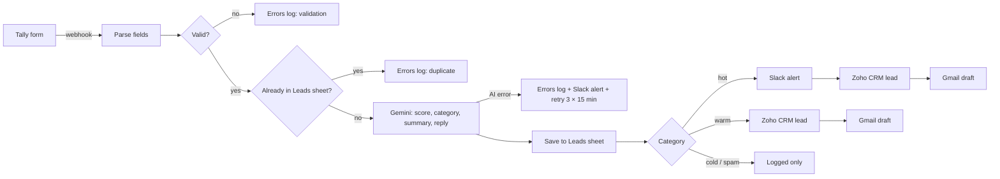
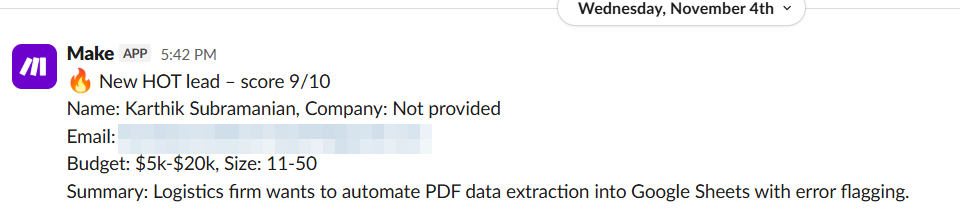
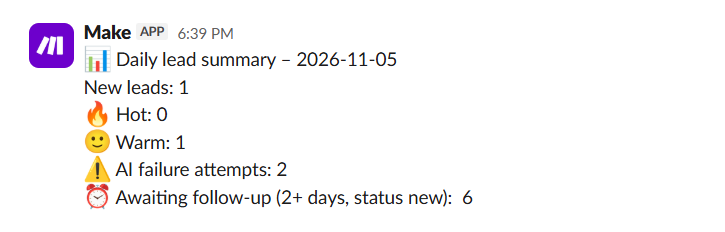
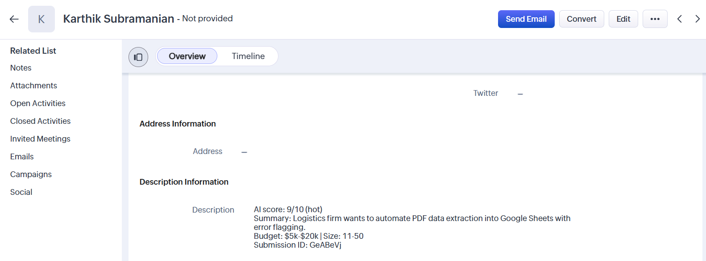
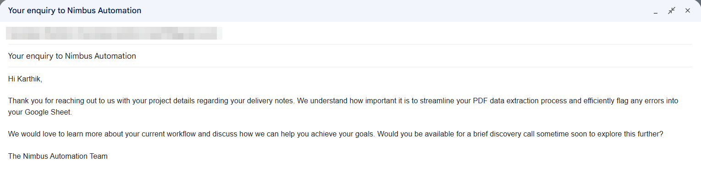
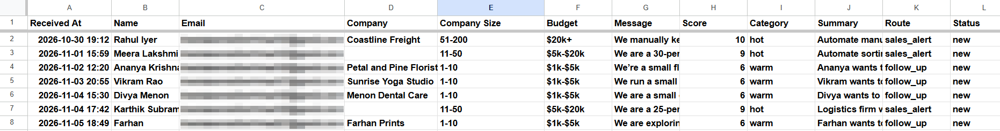
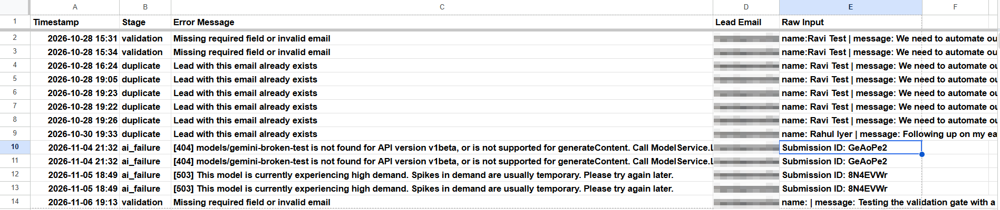
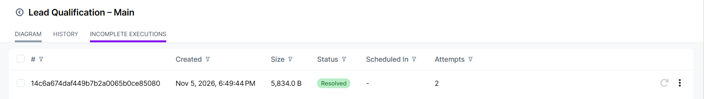
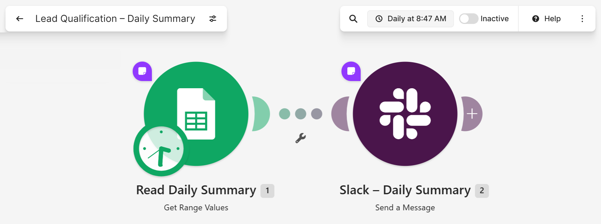

# AI Lead Qualification & Follow-up System (Make.com + Gemini)

An automation that reads every web-form lead, checks it, lets an AI score it, and sends it to the right place: a Slack alert and CRM record for hot leads, a CRM record and draft reply for warm leads, and a log entry for everything else. It handles AI outages on its own and posts a daily summary to the sales channel.

Built in **Make.com** on free plans only, with **synthetic test data**, as a portfolio project.

---

## The problem

A small agency gets enquiries through a website form. Someone has to read each one, decide whether it's worth chasing, copy it into the CRM, tell the sales team, and write a reply. Good leads wait while spam and "just curious" messages take the same attention.

**Goal:** answer the important leads fast, never lose one, and keep a human in control of what gets sent to customers.

## What it does

A second scenario runs **every morning at 8:47 (IST)** and posts yesterday's numbers to Slack: new leads, hot, warm, AI failures, and leads still waiting for follow-up after 2+ days.

| Stage | Tool | What happens |
|---|---|---|
| Capture | Tally (free) | Form with Name, Email, Company, Company size, Budget, Message |
| Validate | Make router + filters | Required fields and email format; invalid leads are logged, not processed |
| De-duplicate | Google Sheets search | Leads already in the sheet are logged as duplicates and skip the AI |
| Qualify | Google Gemini 3.5 Flash Lite (free tier) | Returns JSON: score 1–10, category, one-line summary, reply draft |
| Store | Google Sheets | One row per lead: AI verdict, route taken, follow-up status |
| Act | Slack, Zoho CRM (free), Gmail | Alert, CRM upsert and **draft** reply, depending on category |
| Recover | Make error route | Logs the failure, alerts Slack, retries automatically |
| Report | Second Make scenario | Daily Slack summary, counted by formulas in the sheet |

## Screenshots

| | |
|---|---|
| **Hot lead alert in Slack** — AI summary instead of the raw message  | **Daily summary in Slack**  |
| **Zoho CRM lead** — AI verdict in Description, blank company handled  | **Gmail draft** — written by AI, sent by a human  |
| **Leads sheet**  | **Errors log** — validation, duplicates, a forced 404 and a real 503  |
| **Outage recovery** — parked run resolved after 2 automatic retries  | **Daily summary scenario**  |

Email addresses are blurred. All leads are invented.

## How the AI step works

- **Prompt + schema together.** The [system prompt](prompt/system-prompt.md) explains how to judge a lead; a [response schema](prompt/output-schema.md) locks the answer's shape (`score` is an integer 1–10, `category` is one of four values, every key required). A prompt rule is a request; a schema rule is a lock.
- **Routing on the category, not the score.** Because the category can only be one of four values, the router needs no fallback path.
- **Prompt-injection defence.** Lead text is treated as data. A test lead whose message tried to override the AI's instructions was classified as spam with score 1 and an empty reply.
- **Data minimisation.** The lead's email address is never sent to the AI.
- **Human in the loop.** Replies are saved as Gmail drafts, never sent automatically, because they're written by AI from untrusted input.

## Design decisions

- **Save once, then branch.** One Sheets write before the category router keeps a single source of truth.
- **Cheap checks before the expensive one.** Invalid leads (≈3 credits) and duplicates (≈4) stop before the AI call; a full hot lead costs ≈9.
- **Two layers of validation.** Required fields in the form, plus a validation router in Make. Tested by switching off the first layer.
- **Two layers of de-duplication.** The sheet search, plus a CRM upsert keyed on email, so even an out-of-sync sheet doesn't create a second CRM record (tested).
- **AI verdict kept separate from sales progress.** Category and Score record what the AI thought; Route records what the system did; Status and Zoho's Lead Status are for the sales team.
- **Least data in each tool.** Slack gets the AI summary, not the raw message. Zoho gets the score, summary and a Submission ID for traceability, not the full message or reply.
- **Error handling on the AI step.** Error route → Errors sheet → Slack alert → automatic retry (3 attempts, 15 minutes apart), with Make's incomplete executions acting as a dead-letter queue. The AI sits before every write, so a retry never creates duplicate rows.
- **Lead order not enforced.** "Process data in order" is off, so one parked lead can't block new ones.
- **Counting in the data layer.** The daily summary's numbers are COUNTIFS formulas in a Summary tab; Make reads one row and posts one message (≈2 credits a day) instead of looping over every lead.
- **Follow-up reminder folded into the daily summary.** No extra scenario and no extra credits.
- **Sheet columns stored as plain text.** Stops Google Sheets turning "1-10" into a date, and blocks formula injection from form input.
- **Least-privilege Slack bot**, channel stored by ID, in a separate demo workspace.

## Problems I solved

A selection. The full list is in the test log and project notes.

| Problem | Cause | Fix |
|---|---|---|
| Every lead was flagged as a duplicate | Google Sheets "Search Rows" outputs a bundle even when nothing is found | Check that **Row number does not exist** instead of checking for a bundle |
| Dropdown answers arrived as long IDs | Tally sends option IDs, not text | Look the ID up in the field's options list with `map()` |
| Blank dropdowns were recorded as the first option | Empty value fell through the lookup | `ifempty()` with a `no_answer` sentinel, explained to the AI in the prompt |
| Company size "1-10" became a date | Sheets guessed the type (India locale) | Plain-text columns (also blocks formula injection) |
| Names split wrongly in the CRM | A typed space vanished when Make saved the formula | Used Make's `space` keyword; caught by opening the CRM record, not trusting the green tick |
| AI reply arrived as one squashed paragraph | Gemini returned plain text; email needs HTML | Prompt layout rule + `replace(newline →  )` |
| Real Gemini 503 "high demand" outage | Provider overload | Error route + automatic retries; recovered on the 2nd retry |
| Parked lead was never retried | Automatic retries only run while the scenario is active | Activated briefly to verify, documented as a limitation |
| Daily summary would have posted twice | The header row came back as an extra bundle | Read the data row only (A2:F2) with headers defined separately |
| Follow-up count showed 3 instead of 6 | COUNTIFS used only the first value of `{"hot","warm"}` | Two COUNTIFS added together; caught by checking against a known number |
| HubSpot signup required government ID | Vendor requirement | Switched to Zoho CRM Free |
| Blueprint export contained my email, sheet ID, Slack IDs | Make stores connection labels and IDs | Redacted with placeholders and scanned before publishing |

## Testing

19 tests with synthetic leads, each checked in the actual record (sheet row, Slack message, CRM lead, Gmail draft). They cover hot, warm, cold and spam leads, prompt injection, duplicates, an out-of-sync CRM, invalid input with the form check switched off, a forced AI failure, and recovery from a real outage. See **[test-cases/test-cases.md](test-cases/test-cases.md)**.

## Cost

**$0.** Every tool is on a free plan or free tier, and billing was never enabled.

| Tool | Plan | Limit that matters |
|---|---|---|
| Make | Free | 1,000 credits/month, 2 active scenarios |
| Google Gemini API | Free tier | Flash Lite: 15 requests/min, 500/day |
| Tally | Free | Unlimited submissions, webhooks included |
| Zoho CRM | Free edition | 3 users, 5,000 API credits/day |
| Slack | Free | 10 integrations, 90-day history |
| Google Sheets, Gmail | Free | — |

Approximate Make credits per lead: hot ≈9, warm ≈8, duplicate ≈4, invalid ≈3, each failed AI attempt ≈3. Daily summary ≈2 per day.

## Known limitations

- The webhook has no authentication; anyone with its URL could post to it.
- Make's Gmail app asks for full mailbox access, and Make's default Zoho connection has full CRM read/write; both are broader than this project needs.
- The Gmail OAuth app is in Google's Testing mode, so the connection needs re-authorising periodically.
- Automatic retries only run while the scenario is active.
- Each failed AI attempt adds its own Errors row and Slack alert, and the alert says "retrying" even on the last attempt. The daily "AI failures" count is attempts, not unique leads.
- Lead Status is updated by hand, and the follow-up reminder depends on it.
- The daily summary relies on the sheet recalculating (set to hourly).
- Make's free plan allows 2 active scenarios, so the daily summary can't always be switched on alongside other work.
- The AI doesn't always use the exact "20-minute discovery call" wording, and large budgets reach a score of 10 easily (see the test log).

## Next steps

- Alert sales when an existing hot lead writes in again (today it's only logged as a duplicate).
- Fall back to a second Gemini model when the first is overloaded.
- Log the time of each failed attempt, and count unique failed leads (COUNTUNIQUEIFS).
- Flag a Company value that contains "@" (form autofill put an email address there once).
- Update Status automatically when a reply is sent.
- A small Google Sheets dashboard.

## Repository contents

| Folder | Contents |
|---|---|
| [`blueprints/`](blueprints/) | Exported Make scenarios, with emails, IDs and connection details replaced by placeholders |
| [`prompt/`](prompt/) | Gemini system prompt and output schema |
| [`sample-payloads/`](sample-payloads/) | A real Tally webhook body, cleaned |
| [`test-cases/`](test-cases/) | The 19-test log |
| [`screenshots/`](screenshots/) | Evidence from the running system |

### Importing the blueprints

1. In Make, create a new scenario, open the **⋮** menu and choose **Import blueprint**, then select a file from `blueprints/`.
2. Create your own connections (Google Sheets, Gemini, Slack, Zoho CRM, Gmail). Blueprints never include credentials.
3. Replace `YOUR_SPREADSHEET_ID` and `YOUR_SLACK_CHANNEL_ID` by picking your own sheet and channel in the modules.
4. Create a sheet with **Leads**, **Errors** and **Summary** tabs and the same column headers, and a Tally form with the same questions.
